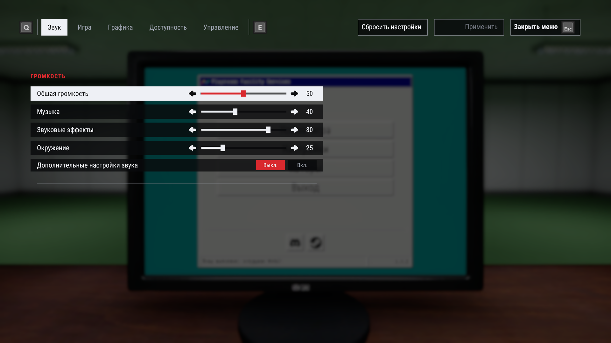

# Playrooms · Русификатор

Полный русский перевод хоррора **Playrooms** со всеми 4 шрифтами под Steam `1.0.2` (сборка `26705387`), а также сборка 2-в-1 с мод-меню для одиночной игры. Достижения в Steam продолжают открываться.

## Скачать
- **[Сборка 2-в-1 (русификатор + мод-меню) и обновления на Boosty](https://boosty.to/cd_tixo/posts/0008f686-0666-4398-a5c7-c8a5b6d26d69?utm_source=github&utm_medium=readme&utm_campaign=playrooms):** единый установщик с выбором нужных модулей и обновлениями под патчи.
- **[Базовый русификатор v1.0 на GitHub Releases](https://github.com/neoru-droid/playrooms-ru/releases/tag/v1.0.0):** только перевод текста и 4 шрифтов · [Как установить](#установка) · [Руководство в Steam](https://steamcommunity.com/sharedfiles/filedetails/?id=3844623165)

Проверено на версии `1.0.2` (сборка Steam `26705387`) для **Windows** и **Steam Deck / Linux**.

## Установка
1. **Windows:** закройте игру, распакуйте архив и запустите `Playrooms-RU-Setup.exe` -> **«Установить русификатор»** (или `Playrooms-Full-Setup.exe` в полной сборке «2-в-1» с Boosty).
2. **Steam Deck / Linux:** распакуйте все файлы архива в одну папку и выполните `sh install-steamdeck.sh` рядом с `.exe`.
3. Кнопка **«Вернуть оригинал»** убирает перевод через тот же установщик. В издании «2-в-1» модули можно ставить и удалять раздельно в любом порядке.

*(Окно SmartScreen на Windows: «Подробнее» -> «Выполнить в любом случае».)*

## Что входит в перевод
- Все 1 439 строк из 6 таблиц локализации (`General`, `Balli`, `Skills`, `Items`, `Mails`, `Popups`) без пропусков: главное меню, настройки, подписи взаимодействия и ночные предупреждения.
- Офисный компьютер `Playrooms95`: корпоративная почта `mail.exe`, магазин `shop.exe`, дерево улучшений `skills.exe`, гардероб роботов, сапёр «Шарики» и все 177 живых реплик скрепки-помощника Балли.
- Внутриигровой телевизор и 40-колоночный телетекст с сохранением цветовой разметки и выравнивания экранов.
- Кириллица во всех 4 шрифтах игры (основной `Roboto Condensed`, пиксельный шрифт терминала и крупный заголовочный шрифт) без «квадратов» и обрезки строк.

## Скриншоты

Открыть игровые кадры

**Главное меню Playrooms95**

**Настройки игры**

**Экран запуска**

**Игровой процесс на русском языке**

## История обновлений
- **[v1.0](https://github.com/neoru-droid/playrooms-ru/releases/tag/v1.0.0)** - первый выпуск перевода (1 439 строк во всех 6 таблицах + 4 кириллических шрифта) под версию 1.0.2 (сборка Steam 26705387).

## Обратная связь и проекты автора

Перевод сделан нейросетью и проверен в игре. Найдёте опечатку или косяк - пишите в [Issues](https://github.com/neoru-droid/playrooms-ru/issues), поправлю.

Все проекты автора: [сайт каталога](https://neoru-droid.github.io/) · [каталог на Boosty](https://boosty.to/cd_tixo/posts/2a55d7e9-0f53-4d93-9f66-280981158dec?utm_source=github&utm_medium=readme&utm_campaign=playrooms) · [профиль на GitHub](https://github.com/neoru-droid)

Лицензия: [MIT](LICENSE) (сведения о шрифтах в `fonts/FONT_LICENSES.txt`)

Автор: `neoru-droid`
