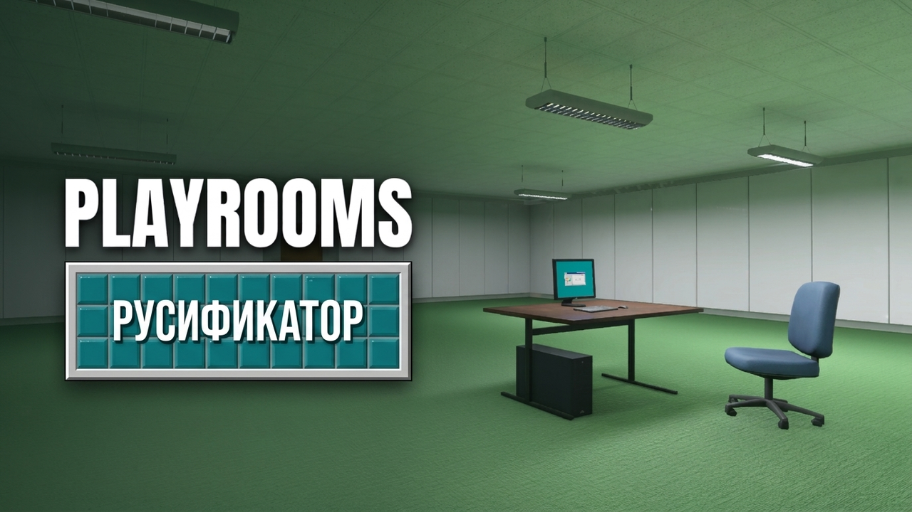
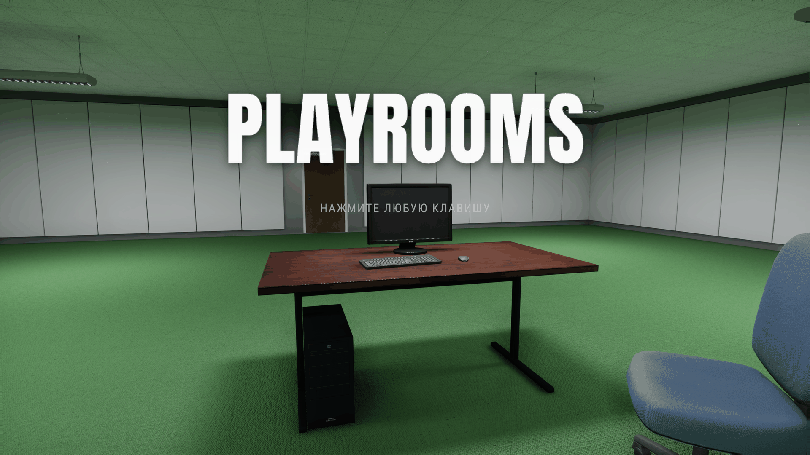
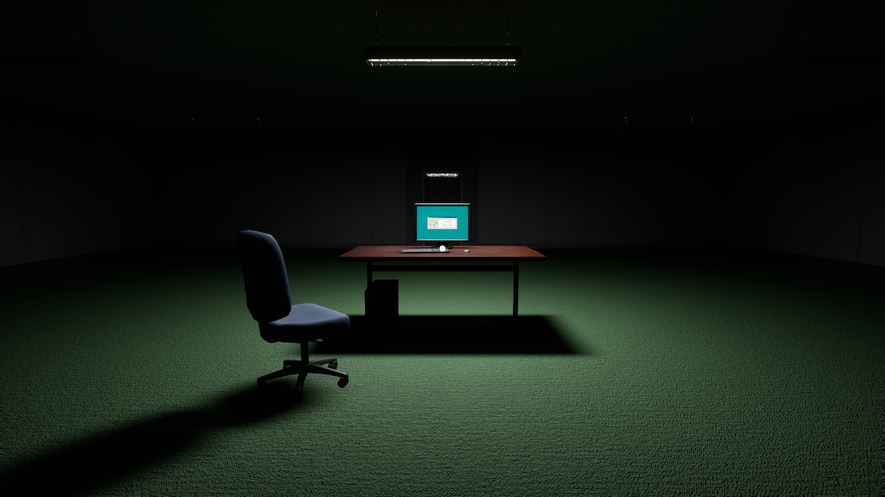

# Playrooms - Русификатор

1 439 строк: система `Playrooms95`, 177 реплик скрепки Балли, почта, магазин, 40-колоночный телетекст и 4 кириллических шрифта (`v1.0`, Steam `1.0.2`, сборка `26705387`, Windows и Steam Deck).

## Скачать
**[Скачать русификатор v1.0 (ZIP)](https://github.com/neoru-droid/playrooms-ru/releases/download/v1.0.0/Playrooms-RU-v1.0.zip)** · [Как установить](#установка) · [Руководство в Steam](https://steamcommunity.com/sharedfiles/filedetails/?id=3844623165)

## Установка
1. **Windows:** закройте игру, распакуйте архив и запустите `Playrooms-RU-Setup.exe` -> **«Установить русификатор»** *(при окне SmartScreen: «Подробнее» -> «Выполнить в любом случае»)*.
2. **Steam Deck / Linux:** распакуйте архив в одну папку и выполните `sh install-steamdeck.sh` рядом с `.exe`.
3. **Откат:** кнопка **«Вернуть оригинал»** в том же установщике.

## Что внутри
- Меню, настройки, ночные предупреждения, `mail.exe`, `shop.exe`, `skills.exe`, гардероб роботов, сапёр «Шарики» и 177 реплик Балли.
- Внутриигровой телевизор и 40-колоночный телетекст с сохранением цвета и выравнивания.
- 4 кириллических шрифта игры (включая `Roboto Condensed` и пиксельный терминал).

## Скриншоты

Открыть игровые кадры (4)

Перевод сделан нейросетью и проверен в игре. Найдёте опечатку или косяк - пишите в [Issues](https://github.com/neoru-droid/playrooms-ru/issues).

[Все переводы автора в Steam](https://steamcommunity.com/id/cd-_-TiXo/myworkshopfiles/?section=guides) · [Релизы](https://github.com/neoru-droid/playrooms-ru/releases) · [MIT](LICENSE) (шрифты: `fonts/FONT_LICENSES.txt`) · Автор: `neoru-droid`
