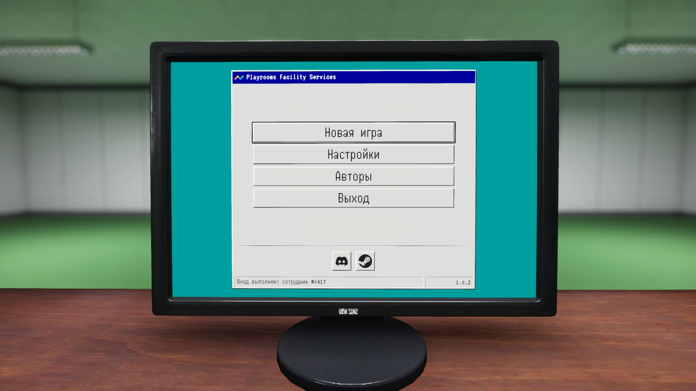

# Playrooms · Русификатор

Весь интерфейс Playrooms95, письма корпорации, 177 реплик скрепки Балли, дерево навыков, инструменты, бегущие строки телетекста и все 4 кириллических шрифта.

**[Скачать перевод v1.0 (ZIP)](https://github.com/neoru-droid/playrooms-ru/releases/download/v1.0.0/Playrooms-RU-v1.0.zip)** · [Как установить](#установка)

Проверено на версии 1.0.2 (сборка Steam 26705387) для Windows и Steam Deck / Linux. Достижения Steam работают в штатном режиме.

## Установка
1. **Windows:** закройте игру, распакуйте архив и запустите `Playrooms-RU-Setup.exe` -> **«Установить русификатор»**.
2. **Steam Deck / Linux:** распакуйте все файлы архива в одну папку и запустите `sh install-steamdeck.sh` рядом с `Playrooms-RU-Setup.exe`.
3. Кнопка **«Вернуть оригинал»** полностью удаляет перевод и побайтно восстанавливает оригинальные файлы игры. Совместимо с [парным мод-меню](https://github.com/neoru-droid/playrooms-trainer-ru) в любом порядке установки и удаления.

*(Окно SmartScreen на Windows: «Подробнее» -> «Выполнить в любом случае».)*

## Что входит в перевод
- Все 1 439 строк из 6 таблиц локализации (`General`, `Balli`, `Skills`, `Items`, `Mails`, `Popups`) без пропусков: главное меню, настройки, подписи взаимодействия и ночные предупреждения.
- Офисный компьютер `Playrooms95`: корпоративная почта `mail.exe`, магазин `shop.exe`, дерево улучшений `skills.exe`, гардероб роботов, сапёр «Шарики» и все 177 живых реплик скрепки-помощника Балли.
- Внутриигровой телевизор и 40-колоночный телетекст с сохранением цветовой разметки и выравнивания экранов.
- Кириллица во всех 4 шрифтовых гарнитурах игры (`Roboto Condensed Regular/Bold SDF`, пиксельный `VT323` на базе `Handjet` и акцидентный `Anton` на базе `Oswald Bold`).

## Скриншоты

Открыть игровые кадры

**Главное меню Playrooms95**

**Настройки игры**

**Экран запуска**

**Игровой процесс на русском языке**

## История обновлений
- **[v1.0](https://github.com/neoru-droid/playrooms-ru/releases/tag/v1.0.0)** - первый полный релиз перевода (1 439 строк во всех 6 таблицах + 4 кириллических шрифта) под версию 1.0.2 (сборка Steam 26705387).

[Все версии](https://github.com/neoru-droid/playrooms-ru/releases) · [Парное мод-меню](https://github.com/neoru-droid/playrooms-trainer-ru)

## Поддержать
- **[Boosty](https://boosty.to/cd_tixo)** (все релизы и выбор следующих игр)
- **[Чаевые через CloudTips (СБП / карта)](https://pay.cloudtips.ru/p/240b8760)**

Перевод сделан с помощью нейросети и проверен в игре. Найдёте опечатку или косяк - пишите в [Issues](https://github.com/neoru-droid/playrooms-ru/issues), поправлю.

## Другие переводы
- [Deleted Wiki: Clean Up the Lost Files](https://github.com/neoru-droid/deleted-wiki-ru)
- [Frontier Tale](https://github.com/neoru-droid/frontier-tale-ru)
- [We March as One](https://github.com/neoru-droid/we-march-as-one-ru)
- [Zombies Aren't Real](https://github.com/neoru-droid/zombies-arent-real-ru)

Лицензия: [MIT](LICENSE) (сведения о шрифтах в `fonts/FONT_LICENSES.txt`)
